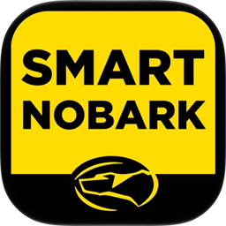

<p align="center">
  
</p>

# Dogtra Smart NoBark — Home Assistant Integration

[](https://github.com/hacs/integration)
[](LICENSE)

Local Bluetooth Low Energy (BLE) custom integration for the **Dogtra Smart NoBark** collar in **Home Assistant**. Works seamlessly with both local Home Assistant Bluetooth adapters and **ESPHome Bluetooth Proxies** — no cloud account or phone app required once configured.

> **Note:** This integration is intentionally built for monitoring in **Count Only** and **Pager (Vibration)** modes only. Static stimulation controls (`Level` and `Auto Increase`) are deliberately omitted.

---

## Features

- **100% Local BLE Push & Polling:** Connects directly to the collar over BLE (`bleak-retry-connector`), sends the standard `0x2A58` sync handshake, and subscribes to real-time `0x2A59` state indications.
- **ESPHome Bluetooth Proxy Compatible:** Automatically uses Home Assistant's built-in `bluetooth` stack, so any ESPHome Bluetooth Proxy in your home extends collar range.
- **Persistent Telemetry When Collar Is Off:** Retains the last known bark count, battery level, and wear time while the collar is powered off or out of range, and reconnects automatically as soon as it advertises again.
- **Real-Time Home Assistant Events:** Fires `dogtra_smart_nobark_bark_detected` on the Home Assistant event bus whenever the bark counter increases.
- **UI Configuration & Diagnostics:** Full Config Flow (Bluetooth auto-discovery or manual MAC setup), Options Flow for polling/protocol overrides, and built-in Home Assistant Diagnostics download.

---

## Entities Exposed

### Sensors
| Entity | Description | Unit / Class |
| :--- | :--- | :--- |
| **Bark Count** | Current bark count reported by the collar | `barks` (`total_increasing`) |
| **Historic Bark Count** | Persistent lifetime bark total — never resets across collar resets, Reset Session presses, or Home Assistant restarts | `barks` (`total_increasing`) |
| **Whine & Howl Count** | Combined whine + howl total (`whine_count` & `howl_count` in attributes) | `events` (`total_increasing`) |
| **Last Bark Detected** | UTC timestamp of the most recent bark | `timestamp` |
| **Battery** | Collar battery percentage (`0–100%`) | `%` (`battery`) |
| **Collar Mode** | Active mode (`Count Only`, `Pager (Vibration)`, `Level`, `Auto Increase`) plus attributes for `stimulation_level`, `auto_increase_*`, `sound_sensitivity`, `vibration_sensitivity`, `alarm`, and `individual_settings` | — |
| **Collar Wear Time** | Active collar uptime / wear duration formatted as `HH:MM:SS` (`seconds` in attributes) | `HH:MM:SS` |
| **Bluetooth Signal** *(Diagnostic)* | Live BLE RSSI | `dBm` (`signal_strength`) |
| **Last BLE Packet** *(Diagnostic)* | Hex dump of the latest 26-byte payload + recent packet history | — |

### Controls (Select, Number & Button)
| Entity | Description | Options / Range |
| :--- | :--- | :--- |
| **Collar Mode** (`select`) | Switch between non-stimulation monitoring modes (`0x02` on `0x2A58`; static stimulation modes are intentionally disabled) | `Count Only`, `Pager (Vibration)` |
| **Volume Sensitivity** (`number`) | Adjust audio/volume bark detection sensitivity (`0xB5` on `0x2A58`, Byte 7) | `1` – `5` (slider) |
| **Vibration Sensitivity** (`number`) | Adjust vibration/motion bark detection sensitivity (`0xB5` on `0x2A58`, Byte 8) | `1` – `5` (slider) |
| **Reset Session** (`button`) | Sends on-device session reset (`0xB0` on `0x2A58`) to the collar | Press to reset |

### Binary Sensors
| Entity | Description | Class |
| :--- | :--- | :--- |
| **Collar Connected** *(Diagnostic)* | Whether Home Assistant currently has an active BLE connection to the collar | `connectivity` |

---

## Installation

### Option 1: HACS (Recommended)
1. Open **HACS** in Home Assistant.
2. Click the **⋮** menu (top right) → **Custom repositories**.
3. Add this repository URL with category **Integration**.
4. Search for **Dogtra Smart NoBark**, click **Download**, and **Restart Home Assistant**.

### Option 2: Manual Installation
1. Copy the `custom_components/dogtra_smart_nobark` folder into your Home Assistant `<config>/custom_components/` directory.
2. Restart Home Assistant.

---

## Configuration

1. Ensure your Home Assistant instance has Bluetooth enabled (local adapter or ESPHome Bluetooth Proxy).
2. **Close the official DOGTRA SMART NOBARK phone app** (BLE collars stop advertising while actively connected to a phone).
3. Go to **Settings → Devices & Services**:
   - When the collar (`DOGTRA_xxxx`) is powered on nearby, it will appear automatically under **Discovered** — click **Configure**.
   - Or click **+ Add Integration → Dogtra Smart NoBark** and enter the collar's Bluetooth MAC address manually (works even while the collar is turned off).

---

## Example Home Assistant Automation

Send a mobile notification whenever your dog barks:

```yaml
alias: Notify on Dog Bark
trigger:
  - platform: event
    event_type: dogtra_smart_nobark_bark_detected
action:
  - service: notify.mobile_app_your_phone
    data:
      title: "Dogtra Smart NoBark"
      message: >
        {{ trigger.event.data.name }} detected {{ trigger.event.data.bark_delta }} new bark(s)
        (Total: {{ trigger.event.data.bark_count }}).
mode: single
```

---

## Verified BLE Protocol Summary

The Dogtra Smart NoBark advertises as `DOGTRA_<last4mac>` with GATT Service `0000181a-0000-1000-8000-00805f9b34fb` (Environmental Sensing):

- **`00002a58`** (`write`): Control / Sync characteristic. Writing the 27-byte Initialise packet (`A1 00...00 01`) prompts an immediate state update.
- **`00002a59`** (`read`, `indicate`): **26-byte Collar State payload**:

| Offset | Length | Encoding | Field |
| :--- | :--- | :--- | :--- |
| `0` | 1 | `uint8` | Instruction (`0x01` Sync, `0x02` Mode, `0x06` Alarm, `0x07` Bark Update) |
| `1` | 1 | `uint8` | Mode (`1` Level, `2` Pager, `3` Auto Increase, `5` Count Only) |
| `2` | 1 | `uint8` | Shock / Stimulation Level |
| `3..5` | 3 | `uint8` | Auto Increase Level, Min Level, Max Level |
| `6` | 1 | `uint8` | Battery Level (`0–100%`) |
| `7` | 1 | `uint8` | Audio / Volume Sensitivity (`0x06`=1, `0x0A`=2, `0x0E`=3, `0x12`=4, `0x16`=5) |
| `8` | 1 | `uint8` | Vibration / Motion Sensitivity (`1–5`) |
| `9..14` | 6 | `uint8` | Interval Bark/Howl/Whine counts & stimulation flags |
| `15` | 1 | `bitmask` | Detection Flags (`0x10` Low Vol, `0x20` Whine, `0x40` Howl, `0x80` Bark) |
| `16..18` | 3 | `3×uint8` | Active / Wear Time (`HH`, `MM`, `SS`) |
| `19` | 1 | `uint8` | Alarm Code (`0x00` None, `0x01–0x04` Fit/Stim, `0x0A–0x0F` 3–8h Wear Reminder) |
| `20..21` | 2 | `uint16 BE` | Bark Total Count |
| `22..23` | 2 | `uint16 BE` | Howl Total Count |
| `24..25` | 2 | `uint16 BE` | Whine Total Count |

---

## Development & Companion Tools

Run the unit test suite locally (no Home Assistant installation required):

```bash
python -m unittest discover -s tests -v
```

Companion diagnostic utilities in `tools/`:
- `tools/discover_collar_ble.py` — Scans for a nearby Dogtra collar, dumps its GATT profile, and records live indications.
- `tools/extract_apk_protocol.py` — Extracts BLE UUIDs and strings from an Android `.apk`/`.xapk` file or via `adb`.

---

*Built with AI assistance and live-tested against a real Dogtra Smart NoBark collar.*
